<div align="center">


# Hetzner Dock

**A self-hosted control panel for sharing Hetzner Cloud servers, dedicated servers and Storage Boxes with your customers, friends and team.**

Everyone gets their own login to restart, rebuild, rescue and watch *their* servers, cloud servers with the console right in the browser and dedicated servers from Hetzner Robot. Nobody needs your Hetzner account.

[](https://github.com/MahdiGraph/HetznerDock/releases)
[](https://github.com/MahdiGraph/HetznerDock/actions/workflows/docker.yml)
[](https://github.com/MahdiGraph/HetznerDock/pkgs/container/hetznerdock)
[](LICENSE)
[](https://github.com/MahdiGraph/HetznerDock/stargazers)

[Install](#install) · [Features](#features) · [Screenshots](#screenshots) · [FAQ](#faq) · [Security](#security)

</div>

<br>

<picture>
  <source media="(prefers-color-scheme: dark)" srcset="docs/screenshots/server-dark.png">
  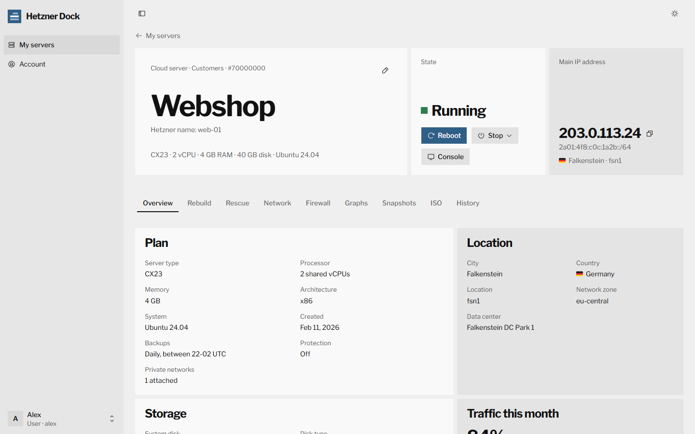
</picture>

## Why it exists

If you rent Hetzner servers for other people, you know the routine. A server stops answering and its owner messages you to reboot it. Someone locked themselves out over SSH and needs the console, a fresh Ubuntu, a reverse DNS record or a new root password, and every time it waits for you. Hetzner grants access per Cloud project or per Robot account, so letting someone in means letting them see and change every server in it.

**Hetzner Dock** is a small web panel you run on any Linux box. You add the API token of each Hetzner Cloud project and the webservice user of each Robot account once, create a login for each person and assign them their servers. From then on they look after their own servers, and you see everything they do in the activity log.

## Features

### For the people you share servers with

- **Power**: reboot, shut down and power on, and reset or power off when the system hangs, with the live state.
- **Console**: the server's screen and keyboard in the browser (noVNC), with Ctrl+Alt+Del and *Type text*, which types a long password or a command for you because the console has no clipboard.
- **Rebuild**: wipe the disk and install any Hetzner image or app, or one of the server's own snapshots and backups. SSH keys or cloud-init user data are optional, and the new root password is shown once.
- **Rescue**: boot the rescue system with an SSH key or a root password and restart into it with one click, or have Hetzner reset the root password of the running system.
- **Network**: reverse DNS for the IPv4 address, any address of the IPv6 /64 and floating IPs, and the private networks the server is in.
- **Firewall**: edit the rules of a firewall that protects only their server, or create one. Firewalls shared with other servers stay read-only for them.
- **Snapshots**: take, rename and delete the server's snapshots, up to the number you allow, and rebuild from them or from a backup.
- **ISO**: put an installer ISO in the virtual drive and install by hand through the console.
- **Graphs**: CPU, network and disk, from the last hour to the last 30 days.
- **History**: everything Hetzner did on the server, with live progress while an action runs.
- **Their own names**: each user can rename a server for themselves. Its name at Hetzner stays as it is.

### Dedicated servers from Hetzner Robot

The same page, with what the [Robot webservice](https://robot.hetzner.com/doc/webservice/en.html) offers:

- **Resets**: Ctrl+Alt+Del, a hardware reset, the power button pressed or held, or a reset by a Hetzner technician, whichever the server supports, plus **Wake on LAN** and the power state where Robot reports it.
- **Rescue**: boot the Linux rescue system or vKVM for the next start, with an SSH key or a root password shown once, and reset into it with one click.
- **Install Linux**: wipe the disks and install any distribution Robot offers, with SSH keys, starting right away or at the next start.
- **Network**: reverse DNS for the main IPv4 address, extra addresses, IPv4 subnets and any address of the IPv6 /64.
- **Traffic**: incoming and outgoing traffic per hour, day or month, for all the server's addresses together.

### Storage Boxes

Storage Boxes of your Hetzner projects join the same list, so backup space is handed out the same way. Their page shows how full the box is and how to connect to it, and lets users:

- **Access**: switch SSH and SFTP, Samba, WebDAV, the snapshot folder and access from outside Hetzner on and off.
- **Password**: set a new one, shown once.
- **Snapshots**: take, delete and roll back to snapshots, and turn automatic daily snapshots on or off.
- **Sub-accounts**: give each machine or person its own login that only sees one folder, read-only if you like.
- **History**: everything Hetzner did on the box, with live progress.

### For you, the admin

- **Several Hetzner projects**: Hetzner ties every API token to one project. Add a token for each project; servers from all of them appear in one list with their **country flags**, type, state and price.
- **Dedicated servers too**: add a Robot webservice user for each Robot account, and its dedicated servers join the same list, with flags, product and state, ready to assign.
- **Users and assignments**: create users, assign servers with a click, disable or reset accounts.
- **You decide what users can do**: switch the console, rebuild, rescue, root password resets, ISOs, reverse DNS and firewall editing on or off, and set how many snapshots a user may keep per server.
- **Overview**: what your servers cost a month, which ones are close to their included traffic, and how many of Hetzner's 3600 hourly API requests are left.
- **Activity log**: who rebooted, rebuilt or changed what, on which server, and what Hetzner answered.
- **Admin tools on every server**: rename it at Hetzner, turn protection and backups on or off, and change its server type. For dedicated servers, rename them in Robot and see when they are paid until and whether they are cancelled.
- **Outbound proxy**: send every API request, to the Cloud API and to Robot, through an **HTTP, HTTPS, SOCKS4, SOCKS5 or SOCKS5h** proxy, with no silent direct fallback. Useful when your server cannot reach Hetzner.
- **Billing stays private**: users never see prices, labels, contract dates or servers that are not theirs.
- **Dark and light themes**, and a layout that works on a phone.
- **Easy to run**: one Docker container with a SQLite database, a one-line installer for amd64 and arm64.

## Install

On a Linux server (Ubuntu, Debian, CentOS, Rocky, Alma, Fedora…) with 1 GB RAM or more:

```bash
curl -fsSL https://raw.githubusercontent.com/MahdiGraph/HetznerDock/main/install.sh | sudo bash
```

The installer:

1. installs Docker and the Docker Compose plugin if they are missing,
2. downloads Hetzner Dock to `/opt/hetzner-dock` and generates a secret,
3. asks **where to listen**: on all addresses (open `http://SERVER-IP:PORT` directly) or on `127.0.0.1` only (behind your own reverse proxy),
4. asks **which port**, suggesting a free one,
5. starts the panel and prints its address.

Open that address and create the admin account right away: the first person to open the panel becomes the admin.

**Update** by running the same command again. It keeps your data, and pressing Enter keeps the current address and port. To skip the questions, put the answers in front of `bash`:

```bash
curl -fsSL https://raw.githubusercontent.com/MahdiGraph/HetznerDock/main/install.sh | sudo LISTEN_ADDRESS=127.0.0.1 PORT=8080 bash
```

<details>
<summary><b>Docker Compose by hand</b></summary>

```bash
git clone https://github.com/MahdiGraph/HetznerDock.git hetzner-dock
cd hetzner-dock
echo "APP_SECRET=$(openssl rand -hex 32)" > .env
docker compose up -d
```

`docker compose up` uses the published image `ghcr.io/mahdigraph/hetznerdock`. If it cannot be pulled, build it locally with `docker compose up -d --build`. Hetzner Dock needs Docker Compose v2, the `docker compose` command (with a space); the old `docker-compose` 1.x is not supported.

</details>

<details>
<summary><b>From source, without Docker (Node.js 20.9 or newer)</b></summary>

```bash
git clone https://github.com/MahdiGraph/HetznerDock.git
cd HetznerDock
npm ci
npm run build
npm start
```

The panel listens on port 3000 and keeps its data in `./data`. Change that with a `.env` file (see [`.env.example`](.env.example)).

</details>

## First steps

1. **Settings → Hetzner projects**: add the API token of every project whose servers you want to share, for example *Customers* and *Friends*, and press **Test**. Create tokens in the [Hetzner Console](https://console.hetzner.com/): open the project, then *Security → API tokens*, and choose **Read & Write**.
2. **Settings → Robot accounts** (for dedicated servers): in [Robot](https://robot.hetzner.com/), open *Settings → Web service and app settings* and create a webservice user. Enter its user name (it looks like `#ws+AbCd1234`) and password and press **Test sign-in**. Robot blocks an address for ten minutes after three failed sign-ins, so test before you save.
3. **Settings → What users can do**: turn off what your users should not do, and set how many snapshots they may keep.
4. **Settings → Outbound proxy** (optional): turn it on if the panel must reach Hetzner through a proxy.
5. **Users**: create a login for each person and send them the generated password.
6. **Servers**: press **Assign** next to a server and tick the people who should manage it.

They sign in at the same address and see only their own servers.

> [!TIP]
> Keep the servers you share in their own Hetzner project. A token can only ever reach the servers of its project, so your private servers stay out of reach even of the panel. A Robot webservice user reaches every dedicated server of its Robot account; the panel only ever touches the ones you assign, and their own addresses.

## Screenshots

| | |
| :-: | :-: |
| 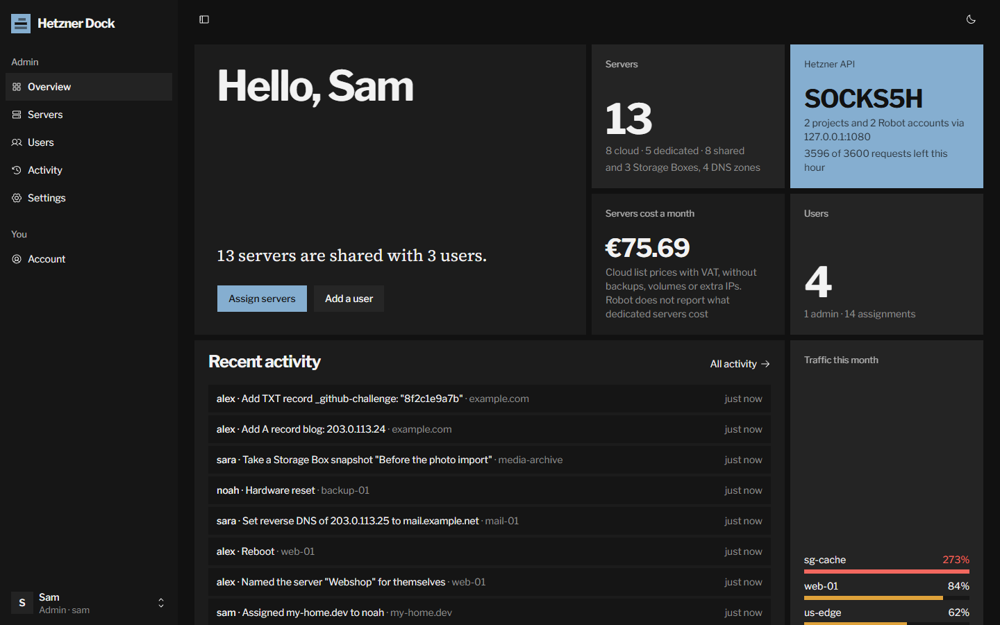 | 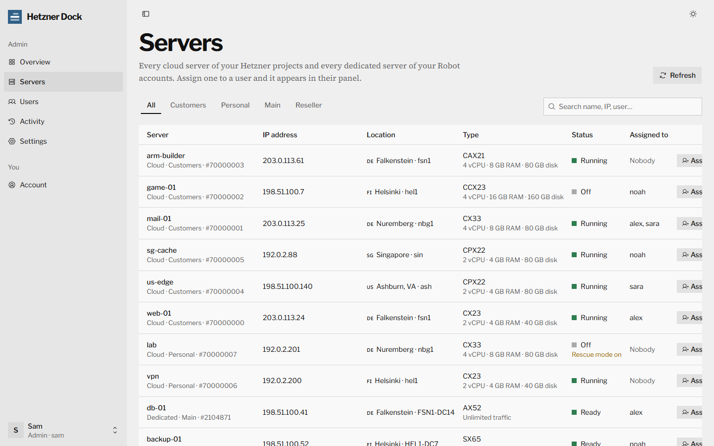 |
| **Overview**: cost, traffic, API budget and activity | **Servers** from every project, with flags |
| 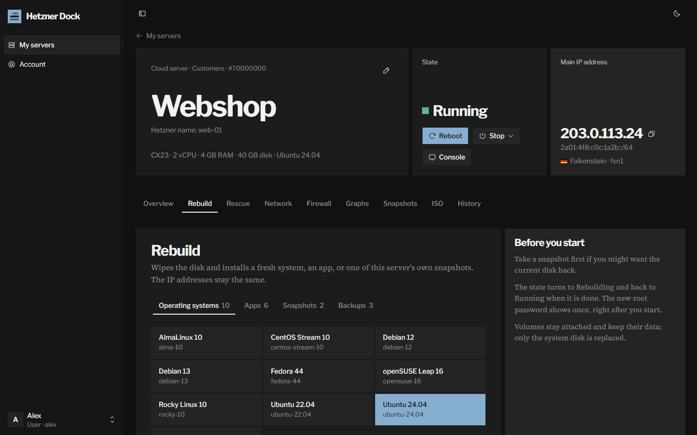 | 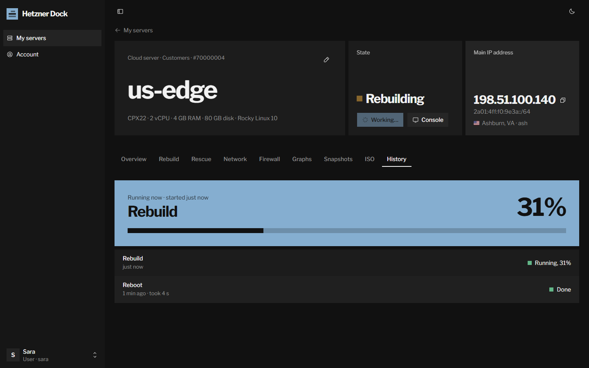 |
| **Rebuild** from an image, app or snapshot | **History**: a rebuild in progress |
| 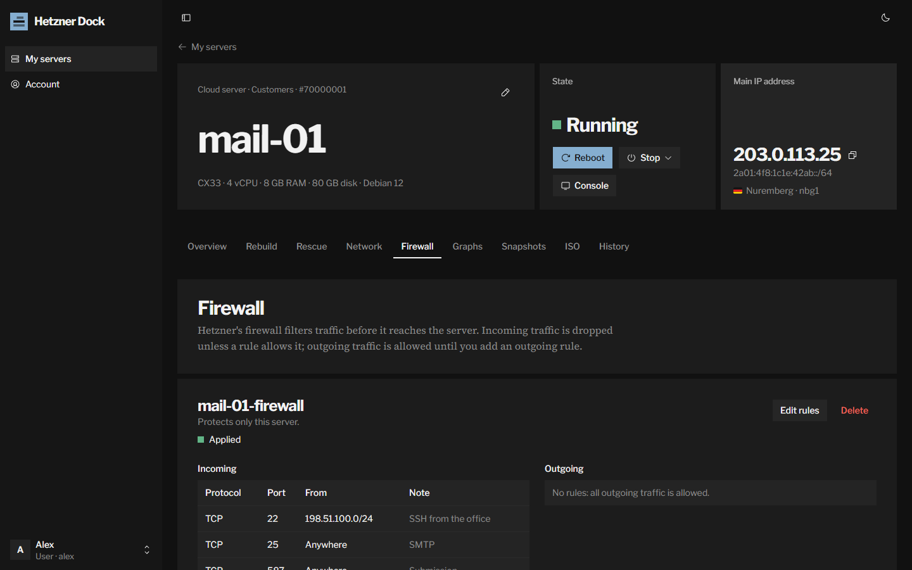 | 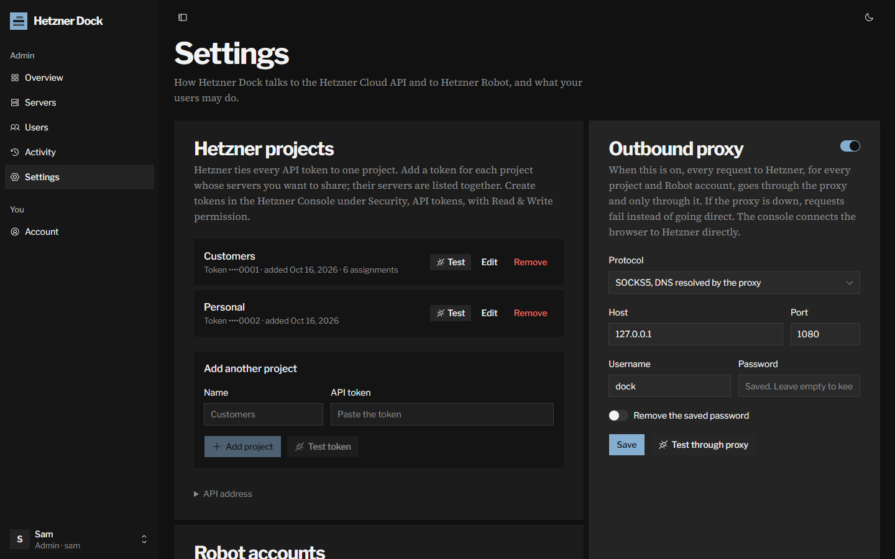 |
| **Firewall** the user can edit | **Settings**: projects and outbound proxy |

<details>
<summary><b>More screenshots</b></summary>
<br>

| | |
| :-: | :-: |
| 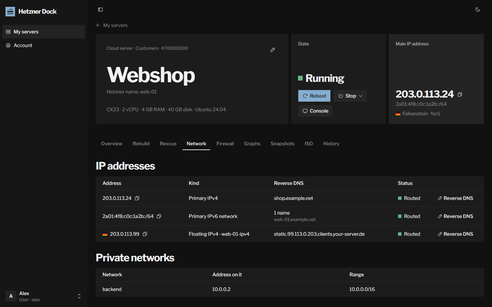 | 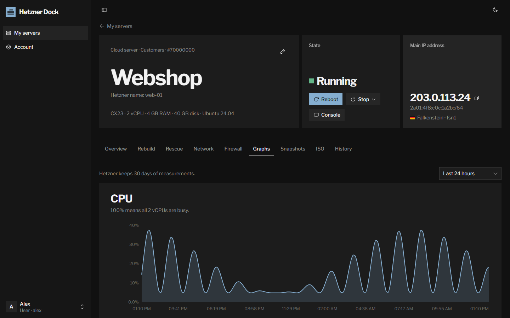 |
| **Network** and reverse DNS | **Graphs** |
| 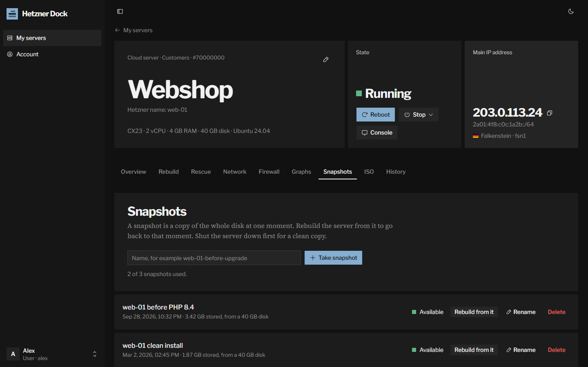 | 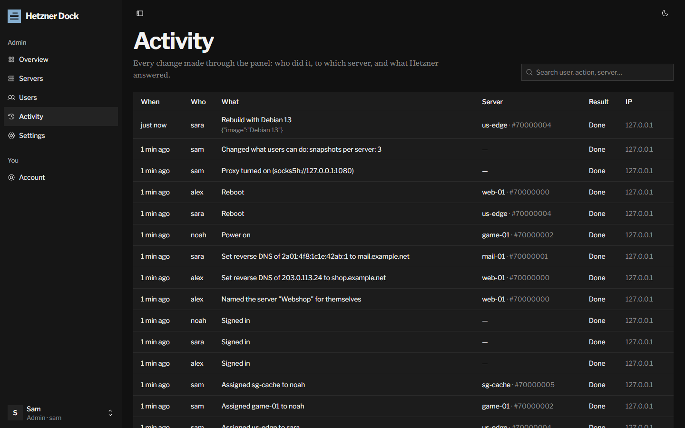 |
| **Snapshots** within the limit you set | **Activity log** |
| 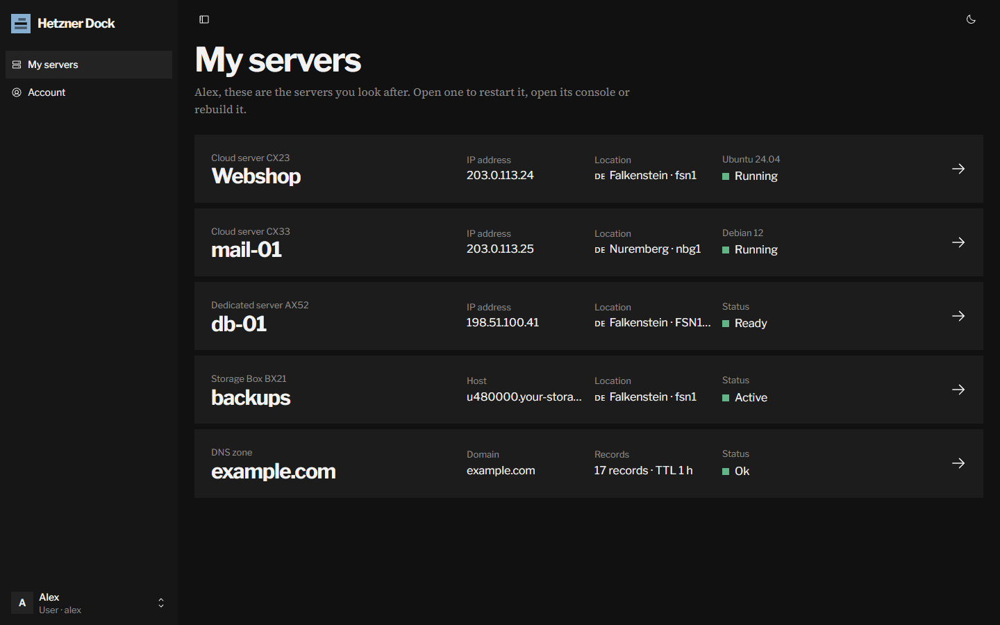 | 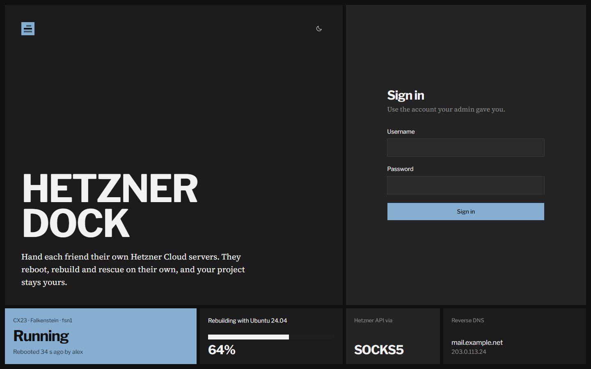 |
| **A user's servers** | **Sign in** |
| 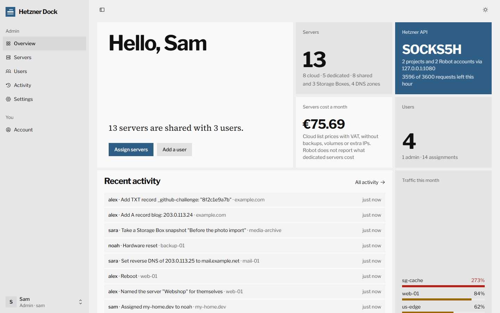 | 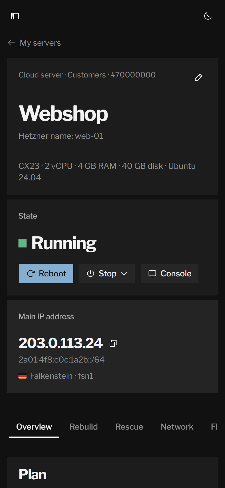 |
| **Light theme** | **On a phone** |

</details>

## What users can do

Everything goes through the [Hetzner Cloud API](https://docs.hetzner.cloud/) with the token of the server's own project.

| On the server page | Hetzner API | Can be turned off |
| --- | --- | --- |
| State, power on, reboot, shut down, reset, power off | `poweron`, `reboot`, `shutdown`, `reset`, `poweroff` | No |
| Console with *Type text* and Ctrl+Alt+Del | `request_console` | Yes |
| Rebuild from an image, app, snapshot or backup, with SSH keys or cloud-init | `rebuild` | Yes |
| Rescue system, optionally with an SSH key and an instant restart | `enable_rescue`, `disable_rescue` | Yes |
| New root password | `reset_password` | Yes |
| ISO images | `attach_iso`, `detach_iso` | Yes |
| Reverse DNS of primary and floating IPs | `change_dns_ptr` | Yes |
| Firewall rules, if the firewall protects only this server | `set_rules`, `firewalls` | Yes |
| Snapshots of this server | `create_image`, `images` | A limit per server, 0 turns them off |
| Graphs, history, volumes, private networks | `metrics`, `actions` | No |

Dedicated servers go through the [Robot webservice](https://robot.hetzner.com/doc/webservice/en.html) with the webservice user of the server's own Robot account, under the same switches:

| On the server page | Robot webservice | Can be turned off |
| --- | --- | --- |
| Resets (Ctrl+Alt+Del, hardware, power button, technician), Wake on LAN, power state | `reset`, `wol` | No |
| Rescue system (Linux or vKVM), optionally with an SSH key and an instant reset | `boot/{server}/rescue` | Yes, with *Rescue mode* |
| Linux installation | `boot/{server}/linux` | Yes, with *Rebuild* |
| Reverse DNS of the server's own addresses and subnets | `rdns` | Yes, with *Reverse DNS* |
| Traffic per hour, day or month | `traffic` | No |

Storage Boxes go through the [Hetzner API](https://docs.hetzner.cloud/reference/hetzner) at `api.hetzner.com`, with the token of the box's own project:

| On the Storage Box page | Hetzner API | Can be turned off |
| --- | --- | --- |
| Access settings, new password, snapshots and their plan, sub-accounts | `update_access_settings`, `reset_password`, `snapshots`, `enable_snapshot_plan`, `subaccounts` | Yes, with *Storage Boxes* |
| Usage, connection details, history | `storage_boxes`, `actions` | No |

Admins can also rename servers at Hetzner, change their protection, backups and server type. Creating and deleting servers, volumes, load balancers and other project-wide resources are deliberately left out: that is what the Hetzner Console is for. In the same way, orders, cancellations, failover IPs, vSwitches and Windows installations stay in Robot, and ordering, resizing and deleting Storage Boxes stays in the Hetzner Console; admins can turn a box's delete protection on or off.

## Outbound proxy

When the proxy is on, **every** request to Hetzner, for every Cloud project and every Robot account, goes through it. If the proxy is down or rejects the login, requests fail with a clear error; the panel never falls back to a direct connection.

| Protocol | Use it for |
| --- | --- |
| SOCKS5, DNS resolved by the proxy (`socks5h`) | Most SOCKS5 proxies. No DNS query for `api.hetzner.cloud` leaves your server. |
| SOCKS5 (`socks5`) | SOCKS5 proxies that need an IP address instead of a host name. |
| SOCKS4 | Old SOCKS4 proxies. |
| HTTP (`http`) | Ordinary HTTP proxies that support `CONNECT`. |
| HTTPS (`https`) | HTTP proxies you connect to over TLS. |

Username and password are optional, and the password is stored encrypted. **Test through proxy** checks the values on screen before you save them.

The console is the one exception: the browser of the person using it connects to Hetzner's console server directly, with a one-minute token the panel asks Hetzner for.

## HTTPS

Do not share the panel over plain HTTP. The simplest setup is [Caddy](https://caddyserver.com) on the same server: choose *127.0.0.1 only* in the installer, point a DNS name at the server, and use the port the installer printed:

```
# /etc/caddy/Caddyfile
dock.example.com {
    reverse_proxy 127.0.0.1:PORT
}
```

<details>
<summary><b>nginx instead of Caddy</b></summary>

```nginx
server {
    listen 443 ssl;
    server_name dock.example.com;
    # ssl_certificate and ssl_certificate_key from certbot or your CA

    location / {
        proxy_pass http://127.0.0.1:PORT;
        proxy_set_header Host $host;
        proxy_set_header X-Forwarded-For $proxy_add_x_forwarded_for;
        proxy_set_header X-Forwarded-Proto $scheme;
    }
}
```

</details>

To switch an existing installation to local-only, run the installer again and choose option 2.

## Configuration

| Variable | Default | Meaning |
| --- | --- | --- |
| `PORT` | `3000` | Port to listen on. With Docker Compose this is the host port, optionally with an address: `127.0.0.1:3000` listens on the local machine only. The installer writes it for you. |
| `APP_SECRET` | generated | Key that encrypts API tokens, Robot passwords and the proxy password. If empty, one is generated and stored next to the database. Never change it after setup, or the tokens and passwords have to be entered again. |
| `DATA_DIR` | `./data` (`/data` in Docker) | Where the SQLite database lives. |
| `NPM_REGISTRY` | `https://registry.npmjs.org/` | Only for building the image yourself: the npm registry or mirror to download packages from. |
| `COOKIE_SECURE` | `auto` | `auto` marks the session cookie Secure when the request came over HTTPS. Set `true` behind a proxy that does not send `X-Forwarded-Proto`. |

## Back up and remove

```bash
# back up the database (keep /opt/hetzner-dock/.env with it: it holds APP_SECRET)
docker run --rm -v hetzner-dock_hzdock-data:/data -v "$PWD":/backup busybox tar czf /backup/hzdock-backup.tgz -C /data .

# remove everything, including data
cd /opt/hetzner-dock && docker compose down -v && cd / && rm -rf /opt/hetzner-dock
```

## Upgrading from HetznerDock 1.x

Version 2 is a rewrite with its own database; it does not read the data of 1.x. Install it with the installer above, add your Hetzner projects again under *Settings*, and create your users. When you no longer need the old panel, remove its container and volume:

```bash
docker rm -f hetznerdock && docker volume rm hetznerdock_data
```

## FAQ

<details>
<summary><b>Is this an official Hetzner product?</b></summary>

No. Hetzner Dock is an independent open-source project that talks to the public [Hetzner Cloud API](https://docs.hetzner.cloud/) and the [Hetzner Robot webservice](https://robot.hetzner.com/doc/webservice/en.html). It is not affiliated with or supported by Hetzner Online GmbH.

</details>

<details>
<summary><b>My servers are spread over several projects. Do I need several panels?</b></summary>

No. Add one API token per project under *Settings → Hetzner projects*. Servers from all of them are listed together, and each call uses the token of the project the server belongs to.

</details>

<details>
<summary><b>Can my users see my prices or my other servers?</b></summary>

No. Each user only reaches the servers assigned to them, through a fixed list of operations. Prices and labels are removed from everything they receive, and they only see snapshots, backups and firewalls of their own servers. For dedicated servers they never see when the server is paid until, whether it is cancelled, or the SSH keys and other servers of your Robot account.

</details>

<details>
<summary><b>Will the panel use up Hetzner's request limit?</b></summary>

Hetzner allows 3600 requests an hour per project. The server list is loaded once for everyone and kept for half a minute, and server pages only check often while something is changing. The overview shows how many requests are left; a busy panel with a handful of users stays far below the limit.

Robot is stricter: it allows 200 server list requests an hour per account, and fewer for resets and Wake on LAN. The panel loads the dedicated server list once a minute for everyone, keeps what each server offers for an hour, and serves server pages from that, so pages left open do not use up the account's limits.

</details>

<details>
<summary><b>Snapshots cost money. Can users run up my bill?</b></summary>

Only as far as you let them. Under *Settings → What users can do* you choose how many snapshots a user may keep per server, or turn snapshots off. Backups, server types and anything else that changes the price are for admins only.

</details>

<details>
<summary><b>My server cannot reach api.hetzner.cloud.</b></summary>

Turn on the outbound proxy under *Settings* and point it at a proxy that can. All Hetzner API traffic then goes through it.

</details>

<details>
<summary><b>Does it work with dedicated servers from Hetzner Robot?</b></summary>

Yes. Create a webservice user in Robot under *Settings → Web service and app settings* and add it under *Settings → Robot accounts*. Its dedicated servers appear in *Servers* next to the cloud servers and are assigned the same way. Users can reset them, send Wake on LAN, boot the rescue system or vKVM, install Linux, set reverse DNS and read their traffic. There is no browser console for dedicated servers: Robot has no API for one, but the vKVM rescue system shows the installed system's screen in the browser.

</details>

<details>
<summary><b>Does it run on ARM servers?</b></summary>

Yes. The Docker image is published for `linux/amd64` and `linux/arm64`, so it runs on Hetzner's Ampere (CAX) servers too.

</details>

<details>
<summary><b>Where is my data stored?</b></summary>

In one SQLite database in a Docker volume (or `./data` when running from source). API tokens, Robot webservice passwords and the proxy password are encrypted with your `APP_SECRET`. Root passwords Hetzner returns, for rebuilds, rescue boots and Linux installations, are shown once and never stored.

</details>

## Security

- Users reach Hetzner only through the panel, which checks every call against their assignments, the settings and a fixed list of operations; each operation checks its input and that every image, IP, subnet and firewall it touches belongs to the server.
- Each server is reached with the API token of its own project, or the webservice user of its own Robot account; one account's credentials are never used for another account's servers. Cloud and dedicated servers are told apart everywhere, so a dedicated server's number can never open a cloud server with the same ID.
- SSH keys users paste for a rescue boot or an installation are added to the project or Robot account for that boot only and deleted again later; users never see or pick the account's own keys.
- Passwords are hashed with scrypt. API tokens, Robot passwords and the proxy password are encrypted with AES-256-GCM.
- Sessions are HTTP-only cookies, sign-in attempts are rate limited, and cross-site requests are refused.
- Every change made through the panel is written to the activity log, without passwords, keys or scripts. Root passwords and console credentials are passed to the browser once and never stored.

Found a vulnerability? Please report it privately, see [SECURITY.md](SECURITY.md).

## Contributing

Issues and pull requests are welcome. [CONTRIBUTING.md](CONTRIBUTING.md) explains how to run the panel locally, including `npm run mock`, a fake Hetzner Cloud API and Robot webservice to develop against without an account. The stack is Next.js 16, React 19, Tailwind CSS 4, [shadcn/ui](https://ui.shadcn.com), SQLite (better-sqlite3) and [noVNC](https://github.com/novnc/noVNC). The visual design follows the [taste skill](https://www.tasteskill.dev) (`.claude/skills/design-taste-frontend`).

If Hetzner Dock saves you a few late-night reboot messages, a ⭐ helps other people find it.

## Credits

The console is [noVNC](https://github.com/novnc/noVNC) (MPL-2.0). Flags are drawn with [Twemoji](https://github.com/twitter/twemoji) (CC-BY 4.0) through the font from [country-flag-emoji-polyfill](https://github.com/talkjs/country-flag-emoji-polyfill), so they show on Windows too.

## License

[MIT](LICENSE). "Hetzner" is a trademark of Hetzner Online GmbH and is used here only to describe what the software works with.
